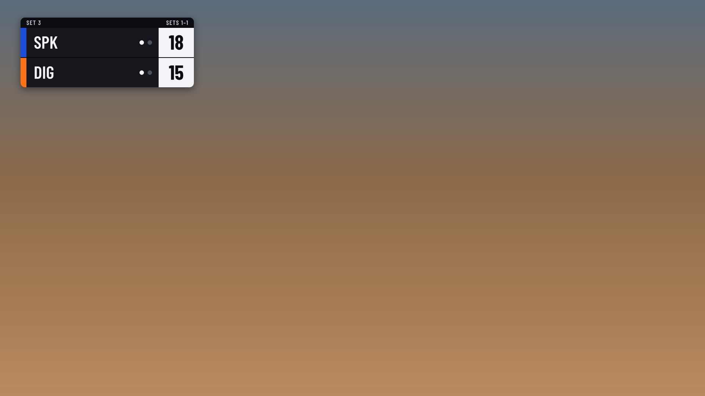
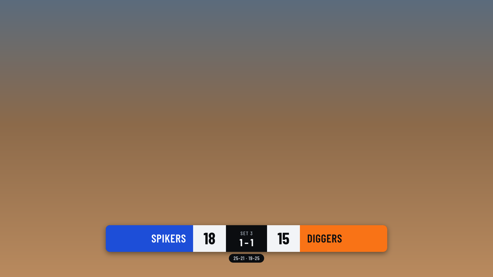
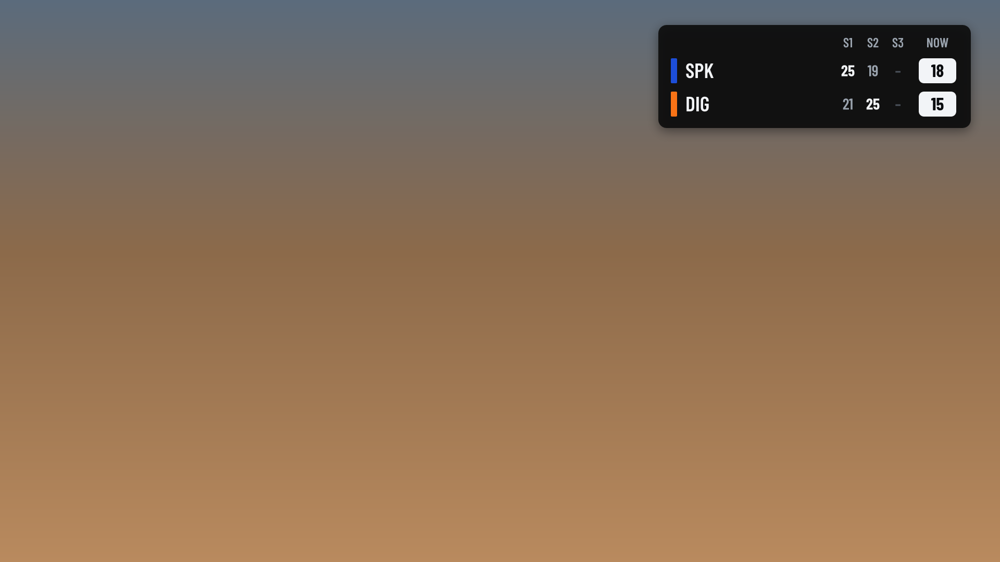

# Broadcast worker

The broadcast worker (package `@scorebug/home-daemon`) turns the phone's stream into
the broadcast. Each live match on scorebug.live runs it in its own Cloudflare
Container. The worker reads the match from Cloudflare Stream over RTMPS, runs FFmpeg
to scale the video and burn in the scorebug, and pushes audio and video over RTMPS to
the match's YouTube broadcast. Score changes are re-rendered and fed to the running
FFmpeg, so it never restarts for a point.

The worker only makes outbound connections.

## The match container

`wrangler deploy` builds the image from this package's `Dockerfile` and deploys it
with the control plane (`containers` in `apps/control-plane/wrangler.jsonc`).

The team's Durable Object starts the container when a match goes live
(`apps/control-plane/src/worker/team-object.ts`). It uses the `standard-4` instance
type with internet access. Outbound HTTP to `api.internal` is intercepted and routed
to the team's Durable Object, so the container holds no credential: its `HOME_TOKEN`
is a fixed placeholder that the intercept makes irrelevant. Stream and YouTube are
reached directly.

The Durable Object stops the container when the match ends, after 4 hours live, or
after 10 minutes without output reports. It restarts a crashed container on its next
alarm.

## How it works

Every 500 ms the worker asks the control plane for its assignment
(`GET /v1/worker/snapshot`, then `GET /v1/worker/connection`, with
`Authorization: Bearer $HOME_TOKEN` and `?workerId=$WORKER_ID`). It runs a broadcast
only when the match is active, the broadcast is set to running, and the broadcast is
assigned to this `WORKER_ID`.

- **Input.** The read URL is Stream's RTMPS playback of the match's live input. The
  worker rejects any other scheme.
- **Output.** The publish URL is the match's YouTube ingest URL with its stream key.
  If the assignment has none, the worker logs `worker_output_missing` and does not
  start FFmpeg.

The worker waits until the control plane reports the source ready before it starts
FFmpeg. It stops FFmpeg when:

- the assignment changes or the match ends (it lets FFmpeg drain for up to 10 seconds),
- the control plane has been unreachable for 5 seconds,
- FFmpeg has produced no new output for `OUTPUT_TIMEOUT_MS`,
- the source has sent nothing for `INPUT_READ_TIMEOUT_MS`.

It retries at most `RETRY_MAX_ATTEMPTS` times per broadcast per minute, at least one
second apart. An attempt that ran for `RETRY_FREE_AFTER_MS` gives its retry back, so
a phone that drops off and returns does not use up the budget. A small guardian
process owns FFmpeg, so FFmpeg is cleaned up even if the worker is killed.

Every second the worker reports its state (`waiting_source`, `starting`,
`producing_output`, `retrying` and so on), FFmpeg's frame and time counters, and its
output profile to the control plane (`POST /v1/worker/sessions` and
`/v1/worker/observations`). The apps use this to show whether the broadcast is live,
and the Durable Object uses it for the idle guard. Logs never contain media URLs or
stream keys.

FFmpeg encodes video with x264 (`veryfast`, `zerolatency`) and audio as AAC at
128 kbps, 44.1 kHz, and publishes FLV.

## Configuration

All settings are environment variables, validated at startup by `src/config.ts`.
`apps/control-plane/src/worker/hosted-media.ts` sets them when it starts the
container; the image sets `SCORE_DIR`.

| Variable                | Container value                                 | Purpose                                                        |
| ----------------------- | ----------------------------------------------- | -------------------------------------------------------------- |
| `CONTROL_PLANE_URL`     | `http://api.internal/`                          | Control API base URL (`http:` or `https:`)                     |
| `HOME_TOKEN`            | A fixed placeholder                             | Bearer token, at least 16 characters                           |
| `WORKER_ID`             | `match`                                         | The worker the control plane assigns the broadcast to          |
| `OUTPUT_ID`             | `youtube`                                       | The output the broadcast must name                             |
| `VIDEO_PROFILE`         | The control plane's `VIDEO_PROFILE` (`1080p30`) | Output size and bitrate, see below                             |
| `SCORE_DELAY_MS`        | The control plane's `SCORE_DELAY_MS` (`1100`)   | Hold each score change this long to line up with delayed video |
| `INPUT_PROBE`           | `fast`                                          | Bound FFmpeg's input analysis for the known Stream source      |
| `INPUT_READ_TIMEOUT_MS` | `4000`                                          | End an attempt when the source sends nothing for this long     |
| `OUTPUT_TIMEOUT_MS`     | `15000`                                         | Restart FFmpeg after this long without new output              |
| `RETRY_MAX_ATTEMPTS`    | `6`                                             | FFmpeg starts per broadcast per minute                         |
| `RETRY_FREE_AFTER_MS`   | `3000`                                          | An attempt that ran this long does not count against the limit |
| `LOG_LEVEL`             | `info`                                          | `debug`, `info`, `warn` or `error`                             |
| `SCORE_DIR`             | `/tmp/scorebug`                                 | Scratch directory for `scorebug.json`                          |
| `FFMPEG_PATH`           | Unset (`ffmpeg` from `PATH`)                    | FFmpeg executable; tests and local runs point it elsewhere     |

Unset, the tuning variables fall back to `VIDEO_PROFILE=1080p30`, `SCORE_DELAY_MS=0`,
`INPUT_PROBE=default`, no read timeout, `OUTPUT_TIMEOUT_MS=10000` and
`RETRY_MAX_ATTEMPTS=3`.

| Profile   | Canvas      | Video bitrate |
| --------- | ----------- | ------------- |
| `240p30`  | 426 × 240   | 350 kbps      |
| `360p30`  | 640 × 360   | 600 kbps      |
| `540p30`  | 960 × 540   | 1.5 Mbps      |
| `720p30`  | 1280 × 720  | 3 Mbps        |
| `1080p30` | 1920 × 1080 | 6 Mbps        |
| `2160p30` | 3840 × 2160 | 18 Mbps       |

Profiles keep the source aspect ratio with padding, cap the frame rate at 30 fps and
set a keyframe every 2 seconds.

## Scorebug overlay

The burned-in scorebug is a raster graphic in one of three styles: `bar` (default),
`lowerThird` and `setCard`.

| `bar`                               | `lowerThird`                                      | `setCard`                                   |
| ----------------------------------- | ------------------------------------------------- | ------------------------------------------- |
|  |  |  |

The style is set per match: pass `scorebugStyle` to `POST /v1/matches`, or change it
during the match with the scorer command
`{ "type": "set_scorebug_style", "style": "setCard" }` (see [the API reference](../../docs/api.md)).

On each score change the worker writes the style, teams, score, best-of and
completed sets to `$SCORE_DIR/scorebug.json`, atomically. `src/scorebug/` turns
that into SVG and rasterizes it with resvg and the bundled Barlow Condensed font
(SIL OFL 1.1, `assets/fonts/OFL.txt`). FFmpeg needs no `drawtext` and the image has
no system fonts.

The overlay reaches FFmpeg as a second input: a live Matroska stream of RGBA frames
on FFmpeg's stdin, at 8 frames per second. FFmpeg keeps the camera's timestamps
(`-copyts`), so each overlay frame is stamped from the latest decoded video
timestamp plus elapsed time plus a 250 ms lead. Only one box per style is sent,
packed into a small canvas, and FFmpeg blends each box at its place with `overlay`.
A score change shows about 0.25–0.4 s after the worker writes it (plus
`SCORE_DELAY_MS`), without restarting FFmpeg or dropping frames. If the overlay feed
stops, `eof_action=pass` keeps the video going without the graphic.

Render the styles to PNG without a stream:

```sh
pnpm --filter @scorebug/home-daemon render-scorebug ./scorebug-samples [--frame=still.png]
```

It writes each style at 1080p and 720p on a transparent background, plus a 1080p
preview over a backdrop (or over `--frame`).

## Run locally

To run the whole path, run the control plane with `wrangler dev` and local containers
turned on (see [Development](../../docs/development.md)). Go live then builds this
image and starts it as the match container.

To run the worker process on its own, outside a container:

```sh
cp apps/home-daemon/.env.example apps/home-daemon/.env
pnpm --filter @scorebug/protocol build
node --env-file=apps/home-daemon/.env apps/home-daemon/node_modules/tsx/dist/cli.mjs apps/home-daemon/src/index.ts
```

The control API is served only through the container's `api.internal` intercept, so
on its own the worker starts, polls and reports `control_unavailable` until something
answers `/v1/worker/*` at `CONTROL_PLANE_URL`. `pnpm --filter @scorebug/home-daemon dev`
runs the same entry point with `tsx watch` and reads settings from the environment.

Build the image from the repository root:

```sh
docker build -f apps/home-daemon/Dockerfile -t scorebug/home-daemon:$(git rev-parse --short=12 HEAD) .
```

The image is Node 22 on Debian Trixie with Debian's FFmpeg and `tini`. It runs
`node apps/home-daemon/dist/index.js`.

## Test

```sh
pnpm --filter @scorebug/home-daemon test
pnpm test:worker-container scorebug/home-daemon:<tag>
```

The unit tests include FFmpeg tests that need `ffmpeg` and `ffprobe` on `PATH`
(override with `SCOREBUG_FFMPEG_PATH` and `SCOREBUG_FFPROBE_PATH`). They write the
FLV that FFmpeg would publish to a file and check its frames, A/V timing and the
burned-in scorebug.

`test:worker-container` starts a built image without network access, as an
unprivileged user with all capabilities dropped. It checks that the worker starts and
reports the control plane unavailable, then runs the real pipeline inside the image
and checks that the scorebug is in the output. CI runs it on pull requests and pushes
to `main`.
