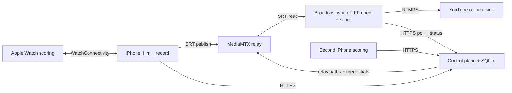

# Architecture

Scorebug streams one volleyball match at a time from one iPhone to one YouTube
destination, with the live score drawn on the video. It is built for one person to
run on a small budget.

## Components

### iPhone and Watch apps (`ios/`)

- **Scorebug** (iPhone) films with the camera, keeps a clean local recording with no
  overlay, and publishes H.264/AAC over SRT to the relay. Recording does not depend
  on the network: it keeps running if the stream, relay, API or worker fails, and
  finished recordings can be exported as normal MP4 files.
- The same app scores a match. A second iPhone can join and take over scoring.
- **ScorebugWatch** scores from the wrist. It mirrors the match open on its paired
  iPhone (filming or scoring) over WatchConnectivity and sends taps back to that
  phone; it holds no server credential.
- Scoring commands go to the control plane over HTTPS. Each command carries an ID and
  the expected revision, and a durable outbox retries after network loss without
  double-counting points.
- Shared Swift packages live in `ios/Packages` (core contracts, media, streaming).
  The iPhone publisher uses the pinned HaishinKit in `vendor/HaishinKit`.

### Control plane (`apps/control-plane`)

A Hono server on Node 22 with SQLite storage.

- `/v1/matches`: create, join and read the active match, send scoring commands,
  and look up the outcome of a command. Owner device token (from a setup link) for
  setup; per-device match credentials after that.
- `/v1/setup`, `/v1/devices`, `/v1/destinations`, `/v1/invites`: setup links,
  owner phones, YouTube destinations and match invites (see [api.md](api.md)).
- `/v1/matches/:id/media`: recording association, broadcast intent (start/stop;
  the server picks the worker and output) and the worker status the app shows (`idle`,
  `starting`, `live`, `reconnecting`, `error`, plus output resolution and bitrate).
- `/v1/worker`: the worker's assignment, relay read credentials, and status
  reports (worker token).
- `/healthz`: liveness.

When a broadcast is requested, the control plane creates relay paths and
per-generation SRT publish/read credentials through the MediaMTX management API, and
hands the publish credential to the phone. It removes them when the broadcast ends.

### Relay (`vendor/MediaMTX`)

MediaMTX 1.21.0 with two small patches: H.264 reader recovery after packet loss, and
bounded draining so a stopped broadcast's last seconds still reach the worker. It
accepts the phone's SRT publish and serves SRT reads to the worker. It only
forwards media; it never re-encodes.

### Broadcast worker (`apps/home-daemon`)

A Node process that wraps FFmpeg. It polls the control plane for its assignment,
reads the stream from the relay, scales it to the selected profile, burns in the
current score, and publishes RTMP(S) to the destination. It can also save the
overlaid output as an MP4. The worker renders the scorebug itself and streams it to
FFmpeg as a second input, stamped from the decoded video's timestamps, so score
changes never restart the encoder. It reports its state to the control plane about
once a second. Encoders: software (x264), VideoToolbox (macOS) or
NVENC. The worker only makes outbound connections, so it can run on a home machine
behind NAT, on the relay host, or anywhere else that can reach the API and relay.

### Shared contracts (`packages/protocol`)

TypeScript types for matches, media state and worker status, plus JSON fixtures that
the Swift tests also read so both sides stay in sync.

## Deployment

`infra/vps` runs the control plane, relay and a Caddy HTTPS gateway with Docker
Compose on a small VPS. The worker runs separately (Docker on Linux, or natively on
a Mac). `infra/local` and `docker-compose.dev.yml` run the relay and a mock RTMP sink
on a development machine.

## Scope

In scope: one active match per installation, one camera, one selected worker, a few
seconds of latency. Out of scope: multiple cameras, multi-tenant hosting,
sub-second latency, automatic failover between hosts.

## Status

Not yet exercised: a real YouTube stream, a remote server deployment, and a full
match from start to finish.
