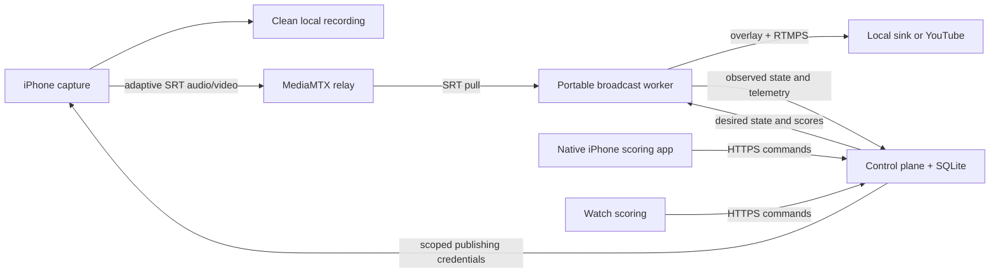

# Scorebug architecture and requirements

Requirements established September 13, 2026; status reconciled September 28.
The native apps and local recording/streaming/scoring vertical are implemented.
The [simulator checkpoint](simulator-acceptance.md) distinguishes verified behavior
from congestion, sustained-operation and deployment gaps. This design supersedes
the May design retained in Git history.

See the [delivery plan](superpowers/plans/2026-09-13-portable-streaming-and-watch.md)
and [local validation runbook](local-testing.md).

## Requirements and priorities

1. Film on an iPhone; score in the native iPhone or Apple Watch app.
2. Reliably record clean audio/video locally on the filming phone, without an overlay.
   Recording works offline and survives server, relay, worker, and network failures.
3. Stream the highest sustainable resolution and useful bitrate while protecting motion:
   initially target 30 fps, with a measured 24 fps floor during viable connectivity.
4. Install the streaming components on a suitable Mac, home computer, or cloud machine.
   No dependency on a particular GPU, hosting provider, or domain.
5. Validate on this Mac and simulators, then physical phone/watch, then other worker hosts.

One-phone operation is a required workflow: the paired iPhone films and streams while
the watch scores. Alternatively, the native app on another iPhone or a watch paired
to that other iPhone can join and score. No second phone or iPad is required for the
paired filming-phone/watch workflow. Browser scoring is outside the product scope;
the existing PWA is a superseded prototype. Prefer reliable operation over any quality or networking optimization.

The first release supports one active match and one selected worker per installation.
Multi-camera, multi-tenancy, and automatic cross-host failover are outside this release.

## Architecture choice

| Approach                                           | Benefit                                                           | Trade-off                                                                   |
| -------------------------------------------------- | ----------------------------------------------------------------- | --------------------------------------------------------------------------- |
| Separate capture, relay, control plane, and worker | Components move independently; recording survives network failure | Recommended; requires explicit synchronization                              |
| Colocate relay, control plane, and worker          | Simplest remote installation                                      | Supported deployment of the same components; needs enough encoding capacity |
| Composite and publish entirely on the phone        | Removes external worker                                           | Deferred; increases phone load and couples recording to graphics            |

The relay forwards media. The worker decodes, adds the score, and re-encodes. A home
worker uses outbound connections; a reachable relay is still required when a phone
cannot directly reach the home network. All components can instead run on one host.
Keep `apps/home-daemon` as the initial source directory, but name the component
**broadcast worker** in new product text. Renaming the directory is not a prerequisite.

## Recording and capture

### Device and OS compatibility

Target iPhone 14 and newer as the required phone family; avoid model-name restrictions
on older phones that run a supported OS and pass capability checks. Support the current
stable major OS plus the previous two release generations. As of this plan that means
iOS 17, 18, and 26, and watchOS 10, 11, and 26 (Apple changed version numbering).
Set deployment targets to iOS 17 and watchOS 10; availability-guard newer APIs and keep
media dependencies out of the watch target. Revisit the release window when a new major
version ships rather than dropping older support accidentally through a dependency bump.

Required physical watch tests are Apple Watch Ultra 2 and Series 7 41 mm. Use responsive
SwiftUI layouts for other supported watches, including smaller SE models; do not require
an Ultra Action button, cellular hardware, or newer gesture APIs. Only use OS-supported
phone/watch pairings from [Apple's compatibility matrix](https://support.apple.com/en-us/118490).
Older OS tests use suitable simulator/runtime combinations; do not downgrade the owner's
devices. Current versions are checked against [Apple releases](https://developer.apple.com/news/releases/).

Use independent recording and publishing state machines. Start local recording without
waiting for a game or network connection; associate its local ID with a game later.
A stream outage leaves recording active. Ending a match remotely ends scoring and
broadcast but does not silently stop local recording. The camera operator explicitly
stops recording, and completed recordings are never automatically deleted.

One capture session supplies timestamped raw samples to bounded, separately owned
archive and live queues. Retain delegates, keep per-frame work off the main actor,
and serialize append/finalize operations. Raw capture frames must be encoded; remove
the existing incorrect assumption that camera buffers already contain H.264.

Archive and live encoders have independent profiles. Start with H.264/AAC live and
SDR/Rec.709. Evaluate HEVC archive after a working H.264 baseline. Target 4K/30 archive
on capable devices; qualify 1080p/30 first. Pick the highest archive profile that
passes simultaneous recording/streaming tests on the actual phone. 60 fps is a later
selectable mode, not a reason to sacrifice the 24 fps floor.

First perform a compatibility experiment: verify resolved HaishinKit APIs, sample
submission, bitrate changes, SRT statistics, simulator binary support, and concurrent
archive/live encoding. Pin the working release and commit `Package.resolved`. The
current upstream toolchain differs from the repository's original Swift 5.10 setup;
use its [compatibility table](https://github.com/HaishinKit/HaishinKit.swift#-requirements).
Do not guess streaming method signatures as the initial scaffold did.

### Durable archive

Use AVAssetWriter segmented fragmented-MP4 output, retaining the initialization segment
and approximately two-second media segments. Write completed segments to temporary
files, finish writes, atomically rename, and update a recovery manifest with timestamps,
profile, and file identities. On recovery, also scan completed files in case termination
occurred between rename and manifest update. Keep buffers and queued disk writes bounded.

The initialization segment plus ordered media fragments form the recording; individual
fragments are not standalone MP4s. On stop/relaunch, reconstruct playback and export a
normal MP4 without re-encoding where tracks permit. Keep source segments until export
is validated. A format change that needs a new initialization segment starts a new
recording part; never concatenate incompatible parts blindly.

Check every writer return value and error. Display recording duration, format, remaining
space, and recording health independently of stream status. Estimate remaining time
from bitrate; retain a reserve for finalization/export. Warn and stop cleanly before
storage exhaustion. A failed export must leave recoverable source segments intact.

Proposed forced-termination acceptance target: retain all completed segments and lose
no more than five seconds of the tail, including bounded write delay. This must be
measured, not assumed from a fragmentation setting. It does not promise recovery from
failed storage or continued capture while the OS has suspended the app.

Keep capture foreground and prevent automatic idle locking while filming. Test explicit
lock, backgrounding, calls, camera interruptions, audio route changes, and thermal
pressure on hardware. Background audio permission does not promise background camera
capture. Finalize recoverable media and visibly mark interruptions. Under resource
pressure reduce streaming load first; if capture must stop, make that explicit.

Apple describes [segment callbacks](https://developer.apple.com/documentation/avfoundation/avassetwriterdelegate)
and [fragmented MP4 authoring](https://developer.apple.com/videos/play/wwdc2020/10011/).

## Adaptive stream quality

Archive, phone-to-relay, and worker-to-destination profiles are separate. A bottleneck
may occur at phone encoding, venue upload, retransmission, worker encoding, or worker
upload. Measure all hops and protect archive quality from network-driven changes.

Use a configurable 30 fps ladder: 480p, 720p, 1080p, 1440p, 2160p. Exclude unsupported
or unqualified formats. Initial H.264 phone-to-relay experiment bands are respectively
1–2, 2–5, 5–10, 10–18, and 18–35 Mbps. These are proposed test parameters, not measured
optima or destination requirements. Use motion-heavy footage when tuning quality.

Proposed controller, calibrated through tests:

- Start conservatively; reserve about 25% of measured sustainable upload for audio,
  retransmissions, overhead, and variation.
- Sample capture drops, unique encoded/received frames, queue age, SRT RTT/loss/
  retransmissions/backlog, worker speed, output progress, and thermal state each second.
- Step down promptly on growing backlog or fresh-frame delivery below 24 fps over a
  rolling five-second window. Reduce bitrate within the rung, then resolution when
  useful quality or encoder capacity requires it.
- Require 30 seconds of stable headroom before cautiously increasing quality. Apply
  hysteresis so fluctuating bandwidth does not repeatedly restart encoders.
- Preserve audio timing and the 30 fps target. Count unique source frames: duplicated
  frames in a constant-frame-rate output must not disguise freezing. Bound live queues.
- If even the lowest profile is unsustainable, show degraded/reconnecting state and
  keep recording. The 24 fps target cannot apply through a complete network outage.

Test resolution changes at keyframes, timestamp continuity, SRT reconnection, and decoder/
filter reinitialization. Initially negotiate a stable destination canvas/frame rate at
preflight. Fit lower-quality source video into it while reporting true source resolution;
upscaling does not restore detail. Enable mid-broadcast destination profile changes only
after sink and YouTube tests. A constrained worker may support less than the camera.

Default to **Best sustainable quality**; offer **Lower delay** with an initial 1080p
YouTube cap. The old 5–10 second latency goal remains an experiment for the lower-delay
profile. YouTube currently uses normal latency for 4K, so that latency goal cannot apply
to every profile. Configure destination bitrate from [YouTube's encoder guidance](https://support.google.com/youtube/answer/2853702?hl=en).

## Portable worker and relay

Add explicit `FFMPEG_PATH`, `FFPROBE_PATH`, encoder choice, font path, working directory,
control-plane/ingest endpoints, and output profile. Probe real short encode/filter jobs,
not just the encoder list. Auto mode chooses a validated backend. A forced unavailable
backend fails preflight clearly. CPU fallback may advertise a lower maximum profile.

Qualify platforms in order:

1. Native macOS arm64: VideoToolbox and CPU fallback.
2. Linux amd64/arm64 CPU containers with bundled fonts and pinned media dependencies.
3. Linux NVIDIA/NVENC with a real GPU and container runtime test.
4. Windows through WSL2, tested separately.
5. Intel QSV/VAAPI and AMD backends when hardware is available for validation.

On this Mac, Docker runs the relay, local sink, and CPU test worker; native Node/FFmpeg
runs the accelerated worker. Do not plan on Apple VideoToolbox inside Docker Desktop's
Linux VM. Docker documents its [Windows/WSL2 GPU path](https://docs.docker.com/desktop/features/gpu/).
An installable worker is not a promise that every machine can encode 4K in real time.

Provide colocated and split deployment examples. Use explicit local Docker port mappings
and service names instead of Linux host-network assumptions. Pin MediaMTX. Provision
matching per-game publish/read passphrases through its private management interface
before accepting a publisher; revoke them after the match. Keep that interface private.
See [MediaMTX passphrase configuration](https://mediamtx.org/docs/references/configuration-file).

The worker waits for source readiness, renders 0–0 before the first point, supervises
FFmpeg, retries with bounded backoff, and reports actual media progress. Source loss may
interrupt the destination connection in v1; automatic recovery is required, seamless
filler is deferred. A running process is not sufficient evidence of working video.

## Shared matches and scoring

Persist game state and command history transactionally in control-plane SQLite. Keep
installation secrets out of public game responses; encrypt persisted destination
credentials using an installation key stored outside the database. Give scoring clients
game-scoped access without video publishing rights or the YouTube key.

Separate match lifecycle, recording lifecycle, desired broadcast state, source state,
and observed worker/output state. Distinguish worker connected, receiving source,
publishing output, reconnecting, and failed. A ready relay source is not proof of a
live YouTube broadcast.

Create/discover one match and let devices join their role. Restore client game IDs from
storage and fetch authoritative state on relaunch. A late or restarted worker gets the
full desired-state snapshot and current score. Use generation numbers to reject stale
start/stop operations. Move between workers explicitly by stop/reassign/start; automatic
failover is deferred. Restarting the control plane must retain the active match.

Replace whole-score overwrites with commands carrying `commandId`, `deviceId`, `gameId`,
`expectedRevision`, and an operation (award point, undo, end set, end match). Deduplicate
command IDs before checking revision, and commit the outcome/state/revision atomically.
A lost acknowledgment must not turn a retry into a second point. Return the latest
snapshot on conflict and serialize each client's outgoing commands.

Persist a client outbox and show pending versus confirmed actions. Retry the same IDs
after brief disconnects. If server state diverged or an action is older than ten seconds,
require reconciliation instead of silently replaying old points. An unacknowledged sent
command is potentially applied until its outcome is queried. Do not hide end-game errors.

Allow one scoring authority at a time with explicit takeover; revisions still protect
delayed requests. Proposed default rules: best-of-three, sets to 25, deciding set to 15,
win by two; also support best-of-five and configurable targets/caps. A tied set cannot
end. Manual override chooses a winner explicitly and is recorded. Share JSON contract
fixtures across Swift and TypeScript; the server is the scoring authority.

## Native iPhone scoring

The iPhone app has Film and Score roles. Score mode is a complete native SwiftUI
experience, not a browser or embedded web page: create/join a match, choose teams
and rules, award points, undo, end sets/matches, see authoritative status, and resume
after relaunch. It requires neither camera/microphone permission nor active recording.
Share the scoring client, command outbox, and protocol models with the watch app.

Required arrangements:

- iPhone A films; its paired watch A scores.
- iPhone A films; the native app on iPhone B scores.
- iPhone A films; watch B, paired to iPhone B, scores. iPhone B is a scorer/setup
  companion and never needs to capture video or remain foreground for direct watch HTTP.

Each scorer joins the same server match using its own scoped authorization. Transfer
scoring authority between phone/watch installations without changing the camera or
interrupting its recording. Bluetooth pairing connects a watch to its own iPhone;
it is not the match-joining mechanism between the filming and scoring devices.

## Apple Watch

Add a SwiftUI watchOS target alongside the full native iPhone scorer and its watch setup/join flow. The paired
phone can be the filming phone or another phone; watch scoring does not depend on
running the camera. Initial scope: point buttons, score/set display, undo, pending and
confirmed states, reconnect status, end-set confirmation, and guarded end-match action.
Test distinct success/error haptics on hardware. Complications, voice, and gestures are
later enhancements.

Use `URLSession` HTTP(S) commands. Fetch authoritative state on wake and acknowledgment;
poll only while the scoring screen is active. watchOS can route requests through the
paired phone, known Wi-Fi, or its own cellular service. Support all three routes and
route changes; the OS selects HTTP routing, rather than the app forcing a radio.
Use an active cellular plan when testing cellular; GPS-only watches use phone/Wi-Fi.
WatchConnectivity is an optional
setup/context transfer and opportunistic command relay, using the same command IDs when
routes change. No permanent watch WebSocket or always-active camera app is required.

Store scoped credentials in Keychain; provision via an expiring code or the authorized
iPhone companion. The watch never needs a stream key. Retain pending actions across
suspension; do not promise instant background updates or transfers.

Apple's [HTTP networking guidance](https://developer.apple.com/documentation/watchos-apps/keeping-your-watchos-app-s-content-up-to-date)
and [low-level networking restrictions](https://developer.apple.com/documentation/technotes/tn3135-low-level-networking-on-watchos)
support this design. Test WatchConnectivity on paired physical devices: [transferUserInfo is unsupported in Simulator](<https://developer.apple.com/documentation/watchconnectivity/wcsession/transferuserinfo(_:)>).

## Validation boundaries

Simulator tests can validate state machines, fixtures, UI, and server interactions.
They cannot certify phone camera quality, sustained dual encoding, heat, battery,
recording interruptions, wrist interaction, or physical watch networking. Every qualified
profile records hardware, dependencies, encoder, and evidence. Higher-quality profiles
stay disabled on a device until its sustained simultaneous recording/streaming gate passes.
