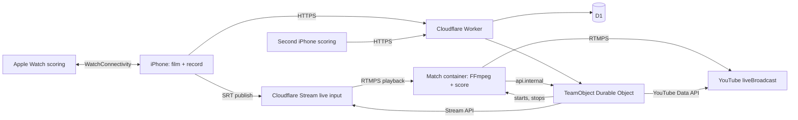

# Architecture

Scorebug streams a youth volleyball match to YouTube from one iPhone, with the live
score burned onto the video. The phone films and publishes; a server-side worker
draws the score and sends the result to YouTube.

It runs as a hosted service at [scorebug.live](https://scorebug.live), on Cloudflare.

## Hosted service

### Worker (`apps/control-plane/src/worker`)

A Hono app on Cloudflare Workers, configured by `apps/control-plane/wrangler.jsonc`
and served at `scorebug.live`. It handles:

- **Sign-in.** Google sign-in through a server redirect. The app opens
  `/v1/auth/google/start` with a PKCE-style challenge. After Google, the callback
  redirects to `scorebug://auth` with a single-use ticket, and the app trades the
  ticket plus its verifier for a long-lived session token (`auth-routes.ts`).
- **Open sign-in.** Any Google account with a verified email can sign in and
  create teams. Admins (the `ADMIN_EMAILS` secret) see every team at `/admin`, a
  server-rendered page (`admin-page.ts`).
- **Teams.** Teams have owners and members. Owners mint team invites (an 8-character
  code and a `https://scorebug.live/invite/<code>` link, optionally bound to one
  email).
- **YouTube channels.** A person connects a channel through a second Google OAuth
  consent with the `youtube` scope. A team owner then picks one of their own
  connections as the team's channel. Refresh tokens and the stream's ingest URL are
  sealed with AES-256-GCM under a key derived from `SERVER_SECRET`
  (`secret-box.ts`).
- **Match routing.** Match requests are forwarded to the team's Durable Object.
  Member routes (`/v1/teams/:teamId/matches/...`) check membership first.
  Match-token routes (`/v1/matches/:id/...`) look up the owning team in D1's
  `match_index`.
- **Match join codes.** `POST /v1/invites/redeem` routes a 6-character code to its
  team through D1's `match_codes` and needs no account.
- **Public pages.** The home page, `/support`, `/privacy`, `/terms`, the `/invite/:code` and
  `/join/:code` landing pages, and the Apple app site association file for
  universal links (`site.ts`, `site-legal.ts`). The App Store buttons use the
  `APP_STORE_URL` var and say "Coming soon" while it is empty. Fonts and icons are static assets
  in `apps/control-plane/public`.
- **Rate limits.** Cloudflare rate-limit bindings: 20 requests a minute per client
  IP on `/v1/auth/*`, and 10 a minute on match code redemption and team invite
  accept.
- **Daily sweep.** A cron trigger (`17 10 * * *`) runs `sweep.ts`. It visits every
  team that could have something running, lets the team object apply its guards
  and stop an orphaned container, deletes Stream inputs no open match uses, and
  drops stale live slots. Each orphan it finds is logged as an error.

### D1 (`apps/control-plane/migrations`)

D1 holds everything that crosses teams: people, session tokens
(SHA-256 hashes only), sign-in tickets, teams, memberships, team invites (keyed
hashes of the codes), `match_index`, `match_codes`, YouTube grants and connections,
and `live_slots`. Each team's matches do not live in D1.

### Team objects

Each team has one `TeamObject` Durable Object, named by the team ID
(`team-object.ts`). Its SQLite storage holds the team's matches, scores, command
receipts, match credentials, match join codes and media state. The match and scoring logic
lives in `src/matches-store.ts`, `src/routes/matches.ts` and `src/routes/media.ts`. A team has at most one active match
at a time.

The object also owns a Cloudflare Container (`containers` in `wrangler.jsonc`,
scheduling policy `durable_object`). The image is built from
`apps/home-daemon/Dockerfile` and started with instance type `standard-4`. The
container's only control channel is `http://api.internal/v1/worker/*`, an outbound
intercept that forwards to its own team object (`worker-api.ts`). It holds no
credential for the API.

### Match flow

1. A team member creates a match (`POST /v1/teams/:teamId/matches`). The Worker
   claims the client-chosen match ID for the team in `match_index`.
2. The filming phone joins with role `capture`. That join creates the match's
   Stream live input early so Go Live is fast.
3. **Go Live** (a `start` media command). Before the command is accepted, the team
   object checks that the team has a usable YouTube channel, creates the match's
   one `liveBroadcast` (unlisted, titled
   `<team 1> vs <team 2> · <date>`) and binds it to the connection's reusable
   `liveStream`, makes sure the Stream input exists, and claims a live slot under
   `LIVE_MATCH_CAP`. Any failure is refused with a reason such as
   `youtube_not_set`, `youtube_live_disabled` or `busy`.
4. The phone asks for its publish URL (`POST /v1/matches/:id/media/publish`, naming
   its publishing attempt) and publishes H.264/AAC over SRT to the Stream input.
5. The team object starts the container. The worker in it polls its assignment,
   reads the input's RTMPS playback URL, burns in the score with FFmpeg and
   publishes RTMPS to the YouTube ingest. It reports its state about once a second,
   and the app shows that state.
6. A `stop` command stops the container. The input and broadcast stay, so the
   next Go Live reuses them.

### Teardown and cost guards

A team object alarm runs every 30 seconds while a match has media open. It renews
the container (which the platform stops after 5 minutes without a renewal) and the
match's live slot, and applies the guards:

- **Match end.** When a match ends, the object stops the container, deletes the
  Stream input and ends the YouTube broadcast. A broadcast that never went live is
  deleted instead.
- **Time limit.** A match is torn down 4 hours after it first went live.
- **Idle.** With no fresh output for 10 minutes, the container is parked. It starts
  again when Stream reports the phone connected, or when the phone asks for its
  publish URL.
- **Crash.** A container that exits while wanted is restarted.

A live slot not renewed for 3 minutes stops counting against `LIVE_MATCH_CAP`. The
daily sweep is the backstop for all of these.

### Deploy

`.github/workflows/deploy.yml` runs on every push to `main` that touches the control
plane, the worker, `packages/protocol` or the lockfile. It applies D1 migrations,
then runs `wrangler deploy`, which also builds and pushes the container image.

## Why the container reads RTMPS playback

The phone publishes SRT to Stream, but the container reads Stream's RTMPS playback
URL, not its SRT playback. Through Stream's SRT playback, the iPhone's HaishinKit
feed arrived corrupted: every frame failed to decode a few macroblock rows in. The
RTMPS playback of the same input decodes cleanly. The container holds score changes
for `SCORE_DELAY_MS` (1100 ms) so the score lines up with Stream's intake delay.

## iPhone and Watch apps (`ios/`)

- **Scorebug** (iPhone) signs in with Google, manages teams, invites and the team's
  YouTube channel, and runs matches. It films with the camera, keeps a clean local
  recording with no overlay, and publishes over SRT. Recording does not depend on
  the network: it keeps going if the stream, API or worker fails, and finished
  recordings export as normal MP4 files.
- The same app scores. Scoring commands carry a command ID and the expected
  revision, and a durable outbox retries them after network loss without
  double-counting points. A second phone joins with a match join code and takes over
  scoring.
- **ScorebugWatch** scores from the wrist. It mirrors the match open on its paired
  iPhone over WatchConnectivity and sends taps back to that phone. It holds no
  server credential.
- Shared Swift packages live in `ios/Packages`. The publisher uses the pinned
  HaishinKit in `vendor/HaishinKit`.

## Broadcast worker (`apps/home-daemon`)

A Node process that wraps FFmpeg. It polls the control plane for its assignment,
reads the match's input, scales it to the selected video profile, burns in the
current score and publishes RTMP(S). It renders the scorebug itself and feeds it to
FFmpeg as a second input, stamped from the decoded video's timestamps, so score
changes never restart the encoder. It only makes outbound connections.

The hosted match container runs it with the software (x264) encoder and
`VIDEO_PROFILE` from `wrangler.jsonc` (`1080p30`). See
[its README](../apps/home-daemon/README.md).

## Shared contracts (`packages/protocol`)

TypeScript types for matches, media state, worker status and invites, plus
JSON fixtures that the Swift tests also read so both sides stay in sync.

## Scope

In scope: one active match per team, one camera, a few seconds of latency.
Out of scope: multiple cameras, sub-second latency, automatic failover between
hosts.
